  

  <h1>𝙃𝙞, 𝙄'𝙢 𝙈𝙮𝙠𝙝𝙖𝙞𝙡𝙤 𝙋𝙖𝙫𝙡𝙤𝙫 </h1>
  
𝗚𝗲𝗻𝗔𝗜 𝗗𝗲𝘃𝗲𝗹𝗼𝗽𝗲𝗿

## 𝗔𝗯𝗼𝘂𝘁 𝗺𝗲

I’m a GenAI Developer and Computer Science master's student. I build AI assistants, LLM applications, and no-code GenAI solutions. My main technologies are Python, TypeScript, React, FastAPI, LangChain, LangGraph, Ollama, ChromaDB, and Docker.

## 𝗖𝗼𝗻𝘁𝗮𝗰𝘁

  

    
    &nbsp;
    
  

## 𝗖𝗼𝗻𝘁𝗿𝗶𝗯𝘂𝘁𝗶𝗼𝗻 𝗦𝗻𝗮𝗸𝗲

  

  

